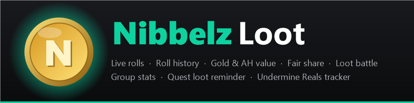

# Nibbelz Loot

A World of Warcraft addon for **WoW Forever** that shows, live, who picked **Need**, **Greed** or **Pass** on every group roll, and who is still choosing. It keeps a roll history by day and dungeon, adds up the gold and auction house value of everything you won, and tracks the coins you loot. It also reminds you to loot quest items and tracks your daily Tarnished Undermine Reals.

English and German.

## Features
- **Loot Rolls window**: one card per item with a timer, every player's choice and roll, class colours. Collapsible, scrollable, resizable. You choose how long it stays open after the last roll (never opens, 1-60 seconds, or stays open).
- **Roll history**: by day and dungeon, with vendor value, AH value and looted money (gold, silver, copper). Pick which stats you see, for only you or the whole group. Search items or players.
- **Group stats**: everyone you ran with, items, gold and AH value won, sortable, grouped by guild, compare players over the runs you did together. Right-click a player for their loot history.
- **Quest loot reminder**: enemies that drop an item your quest still needs are marked in their tooltip; after the kill the item's icon pops up on screen (movable, size and time adjustable, can be switched off). Separate switches for dungeons and outdoors.
- **Undermine Reals**: which bosses from Sunken Temple / Blackrock Depths on already gave you today's Tarnished Undermine Reals, your total and the time until reset. Searchable, per character.
- **Fair share**: who has to trade whom how much so everyone ends up with the same gold. Only counts in dungeons, early leavers only share until they leave.
- **Loot battle**: contest or tip game with gold stake, loot categories and extra bets (damage, healing, killing blows, ...). Players without the addon join via `!join` in chat.
- **AH prices** from TradeSkillMaster, Auctionator, Auctioneer or NaowhForever.
- Sound on a rolled 100, hides Blizzard's roll spam in chat, six window styles, minimap button.

## Commands
| Command | What it does |
|---|---|
| `/nl` or `/rolls` | Loot Rolls window |
| `/rolls options` | Options |
| `/rollhistory` | Roll history |
| `/rolls players` | Group stats |
| `/fairshare` | Fair share |
| `/lootbattle` | Loot battle |
| `/reals` | Undermine Reals |

## Install
Download the latest release (or the zip from CurseForge) and put the `NibbelzLoot` folder into
`World of Warcraft\_forever_\Interface\AddOns`.

## Changelog
See [CHANGELOG.md](CHANGELOG.md).

## License
All Rights Reserved. See [LICENSE.txt](LICENSE.txt).
